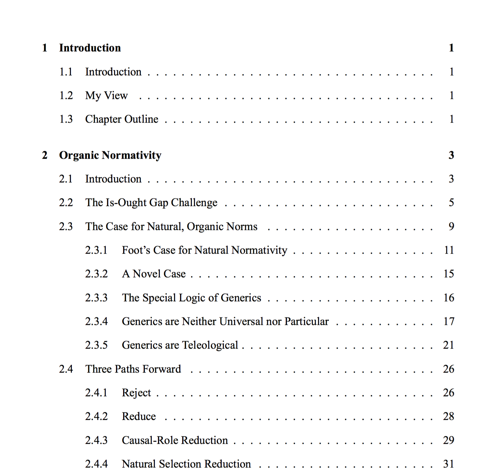

I've created a [repository](https://github.com/keithbuhler/dissertation-story) with my basic files to format academic papers, including dissertations. Mine is a philosophy dissertation, but this should work for any work in humanities.

Writing a dissertation is hard; *formatting* all that content is hard in a totally different way. The goal of this template is to empower you to format your dissertation in a way that is beautiful, clean, and (relatively) easy by taking away some of the initial missteps and allowing you to troubleshoot your way forward. 

The template is under construction and should be finished by the end of 2016. I'm also working on video instructions on how to put all the magic into use.

As a taste, this is the auto table of contents generated with a single click by Pandoc+Latex. 

<!--more-->

